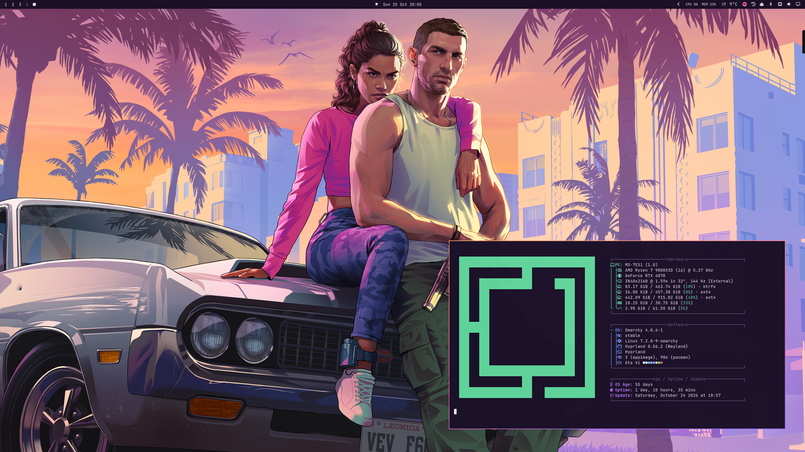

# GTA VI

A theme for [Omarchy](https://omarchy.org/) inspired by Grand Theft Auto VI:
dusk-violet Vice City skies, a hot Vice pink accent, sunset peach and ocean teal
highlights. Active window borders follow the VI logo gradient, running from
sunset orange through Vice pink to twilight purple.

## Preview



## Backgrounds

The wallpapers are the official Grand Theft Auto VI artwork and Leonida
postcards released by Rockstar Games for desktop use. They remain the property
of Rockstar Games / Take-Two Interactive and are not covered by the license below.

## Installation

```bash
omarchy theme install https://github.com/dbohry/omarchy-gta6.git
```

Or, from within an existing checkout:

```bash
omarchy theme set gta-vi
```

## Full setup

To get everything in the preview, install the theme and its three companion
plugins, then restart the shell once at the end. Each plugin only comes alive
while this theme is active, so switching to another theme gives you the stock
look back without uninstalling anything.

1. Install and apply the theme:

   ```bash
   omarchy theme install https://github.com/dbohry/omarchy-gta6.git
   ```

2. Swap in the [floating island bar](#bar):

   ```bash
   omarchy plugin add https://github.com/dbohry/omarchy-gta6-bar.git
   omarchy bar use gta6-bar
   ```

3. Replace the workspace indicators with the [sliding Vice pink pill](#workspaces),
   in the same spot on the bar:

   ```bash
   omarchy plugin add https://github.com/dbohry/omarchy-gta6-workspaces.git
   omarchy plugin enable gta6-workspaces --before omarchy.workspaces
   omarchy plugin disable omarchy.workspaces
   ```

4. Replace the [lock screen](#lock-screen):

   ```bash
   omarchy plugin add https://github.com/dbohry/omarchy-gta6-lock.git --enable
   omarchy plugin disable omarchy.lock
   ```

5. Optional: install the Pricedown font for the lock screen's mission cards
   (see the [GTA 6 Lock README](https://github.com/dbohry/omarchy-gta6-lock#font)).
   Without it, the cards use the default font.

6. Optional: round the window corners to 8px to match the bar islands. Omarchy
   doesn't load Hyprland settings from a theme installed from git, so the theme
   ships a hook that applies them instead, only while this theme is active:

   ```bash
   omarchy hook install theme-set ~/.config/omarchy/themes/gta6/hooks/window-rounding
   omarchy theme set gta6
   ```

   Or, to round windows on every theme, add this to `~/.config/hypr/looknfeel.lua`:

   ```lua
   hl.config({
     decoration = { rounding = 8 },
   })
   ```

7. Restart the shell so everything loads cleanly:

   ```bash
   omarchy restart shell
   ```

`omarchy plugin add` asks you to confirm each plugin before cloning it, since
plugins run as code inside the shell. Answer no if it then offers to enable the
bar or workspaces plugin; the commands after it take care of that.

The sections below cover each plugin on its own.

## Lock screen

Pair the theme with [GTA 6 Lock](https://github.com/dbohry/omarchy-gta6-lock),
a lock screen plugin that comes alive while this theme is active: a neon sweep,
`LOCKED` and `WELCOME BACK` mission cards, wanted stars for the password and a
`BUSTED` card on a wrong one.


```bash
omarchy plugin add https://github.com/dbohry/omarchy-gta6-lock.git --enable
omarchy plugin disable omarchy.lock
omarchy restart shell
```

See its [README](https://github.com/dbohry/omarchy-gta6-lock#readme) for the
Pricedown font it uses and how to switch back to the stock lock screen.

## Bar

Float the top bar with [GTA 6 Bar](https://github.com/dbohry/omarchy-gta6-bar),
a bar plugin that comes alive while this theme is active: the left, center and
right sections each float in their own rounded island with a soft sunset
gradient border, lined up with the windows below.


```bash
omarchy plugin add https://github.com/dbohry/omarchy-gta6-bar.git
omarchy bar use gta6-bar
omarchy restart shell
```

See its [README](https://github.com/dbohry/omarchy-gta6-bar#readme) for tuning
the islands and how to switch back to the stock bar.

## Workspaces

Pair it with [GTA 6 Workspaces](https://github.com/dbohry/omarchy-gta6-workspaces)
too, a bar widget that comes alive while this theme is active: the focused
workspace sits in a Vice pink pill that slides between workspaces, and the rest
are colored sunset orange and dusk purple. On the stock bar it also runs a
sunset gradient line along the bar's edge.


```bash
omarchy plugin add https://github.com/dbohry/omarchy-gta6-workspaces.git
omarchy plugin enable gta6-workspaces --before omarchy.workspaces
omarchy plugin disable omarchy.workspaces
omarchy restart shell
```

See its [README](https://github.com/dbohry/omarchy-gta6-workspaces#readme) for
tuning the slide and how to switch back to the stock workspaces widget.

## License

The theme files (colors, config) are MIT. Artwork belongs to its owners.
